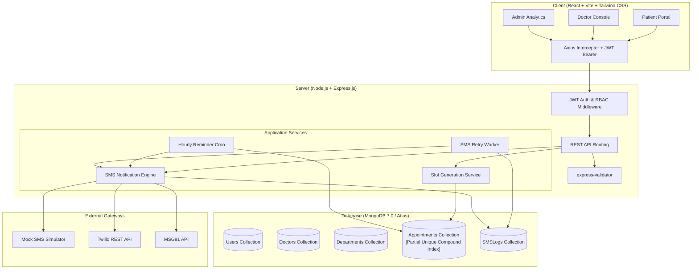

# MediBook – Smart Hospital Appointment Booking & SMS Notification System

[](https://reactjs.org/)
[](https://nodejs.org/)
[](https://opensource.org/licenses/MIT)

MediBook is an advanced, production-grade MERN Stack Hospital Management, Outpatient Scheduling, and Real-Time SMS Notification Gateway. Designed to eliminate clinic congestion, double-booking race conditions, and missed appointments, MediBook empowers patients, specialist doctors, and hospital administrators with specialized role-based portals.

---

## 🌟 Key Features

### 1. 🛡️ Atomic Concurrency & Zero Double-Booking Guarantee
- Prevents race conditions when multiple patients attempt to book the same doctor, date, and slot simultaneously.
- **Engine-Level MongoDB Compound Partial Unique Index**:
  ```javascript
  appointmentSchema.index(
    { doctorId: 1, appointmentDate: 1, 'timeSlot.startTime': 1 },
    {
      unique: true,
      partialFilterExpression: {
        status: { $in: ['pending', 'confirmed', 'rescheduled'] }
      }
    }
  );
  ```
- Instant friendly `409 Conflict` resolution with real-time feedback.

### 2. 📱 Multi-Gateway SMS Notification Engine
- **Providers Supported**:
  - **Mock SMS Simulator**: Built-in zero-dependency testing engine. Prints formatted SMS dispatches to console and logs status to MongoDB. Allows evaluators and examiners to test 100% of SMS workflows without requiring paid API keys!
  - **Twilio**: Production SMS dispatch via official Twilio REST API.
  - **MSG91**: Enterprise SMS dispatch via MSG91 API with DLT template ID support.
- **Automated Event Triggers**:
  - `BOOKING_CONFIRMATION`: Instant SMS dispatch upon successful booking.
  - `APPOINTMENT_REMINDER`: Automated hourly cron job alerting patients 24 hours prior to appointment.
  - `BOOKING_RESCHEDULED`: Alert dispatched when either party changes appointment time.
  - `BOOKING_CANCELLED`: Alert dispatched with reason when booking is cancelled.
- **Telemetry & Retry Worker**:
  - Every outbound SMS is recorded in `SMSLog` with carrier timestamp and delivery status.
  - Failed messages are automatically queued for retry with exponential backoff.
- **TCPA / GDPR Consent & Opt-Out**:
  - Patient consent flag (`smsConsent: boolean`) stored securely.
  - Patients can toggle consent anytime in their profile.
  - Inbound webhook handler (`/api/sms/webhook`) listens for `STOP` and `START` keywords.

### 3. 👥 Role-Based Portals & Dashboards
- **Patient Dashboard**:
  - Search doctors by specialization, rating, fee, and clinical department.
  - Real-time slot picker with dynamic booked-slot strikethrough.
  - Printable medical appointment passes with official reference numbers (`MDB-YYYYMMDD-XXXX`).
  - Reschedule and cancellation requests.
  - Profile and SMS consent preferences.
- **Doctor Clinical Console**:
  - Live patient queue for today.
  - Weekly shift schedule editor (working days, start/end hours, break times, and slot duration: 15–60 mins).
  - Consultation notes and e-prescription builder (dosage, frequency, duration, instructions).
  - Approve pending appointments or reschedule.
- **Admin Governance & Analytics**:
  - Hospital analytics (Patients, Doctors, Appointments, Revenue).
  - SMS gateway delivery rates, status breakdowns, and retry buttons for failed SMS logs.
  - Doctor management (register, edit, assign department).
  - Patient directory and consent audits.
  - Hospital department management.

---

## 🏗️ System Architecture



---

## 🗂️ Project Directory Structure

```
medibook/
├── client/                      # React 18 + Vite + Tailwind CSS Frontend
│   ├── public/
│   ├── src/
│   │   ├── api/                 # Axios API clients for all micro-endpoints
│   │   ├── components/
│   │   │   ├── common/          # Navbar, Footer, Sidebar, Modal, StatusBadge
│   │   │   ├── appointment/     # SlotPicker, BookingModal, RescheduleModal, SlipModal
│   │   │   ├── doctor/          # DoctorCard, DoctorScheduleEditor, ConsultationModal
│   │   │   └── admin/           # MetricCard, SMSLogTable, DoctorFormModal, DeptModal
│   │   ├── context/             # AuthContext (JWT state & SMS consent handler)
│   │   ├── hooks/               # useAuth custom hook
│   │   ├── pages/
│   │   │   ├── HomePage.jsx     # Landing hero, departments, specialties
│   │   │   ├── LoginPage.jsx    # One-click demo evaluator logins
│   │   │   ├── RegisterPage.jsx # Patient registration with SMS opt-in
│   │   │   ├── DoctorsPage.jsx  # Doctor search, filters, and cards
│   │   │   ├── DoctorDetailPage.jsx # Doctor bio & live booking slot picker
│   │   │   ├── patient/         # Patient dashboard, appointments, profile
│   │   │   ├── doctor/          # Doctor dashboard, queue, schedule manager
│   │   │   └── admin/           # Admin dashboard, doctors, patients, SMS logs
│   │   ├── utils/               # Formatters for currency, dates, phone numbers
│   │   ├── App.jsx              # Routes with ProtectedRoute RBAC guards
│   │   ├── main.jsx             # React DOM root entry
│   │   └── index.css            # Tailwind directives & print styles
│   ├── index.html
│   ├── package.json
│   ├── tailwind.config.js
│   └── vite.config.js
│
├── server/                      # Node.js + Express.js Backend API
│   ├── src/
│   │   ├── config/              # db.js, constants.js
│   │   ├── controllers/         # auth, doctor, patient, appointment, admin, sms
│   │   ├── middleware/          # auth (RBAC), error (E11000 double booking), validate
│   │   ├── models/              # User, Doctor, Department, Appointment, SMSLog
│   │   ├── routes/              # Express API routers
│   │   ├── seeds/               # Comprehensive seedData.js with demo accounts
│   │   ├── services/
│   │   │   ├── sms/             # smsService, twilioProvider, msg91Provider, mockProvider, templates
│   │   │   ├── cron/            # reminderCron.js, smsRetryWorker.js
│   │   │   └── slotService.js   # Dynamic conflict-free slot calculator
│   │   ├── utils/               # apiResponse, logger, asyncHandler
│   │   ├── app.js               # Express application configuration
│   │   └── server.js            # HTTP listener & background cron initializer
│   ├── tests/                   # Jest & Supertest automated test suites
│   ├── package.json
│   ├── .env.example
│   └── .env
│
├── docker-compose.yml           # Multi-container orchestration (MongoDB + Node + Nginx)
├── Dockerfile.server
├── Dockerfile.client
├── README.md                    # Project documentation
├── PROJECT_REPORT.md            # Comprehensive academic final-year project report
└── package.json                 # Root script runner (concurrently)
```

---

## 🚀 Quick Start Guide

### 1. Prerequisites
- **Node.js** (v18 or v20+)
- **npm** (v9+)
- **MongoDB** (Local instance or free MongoDB Atlas URI). *Note: The server includes an auto-fallback to an embedded in-memory database for local testing if a local MongoDB service is not started!*

### 2. Clone and Setup Environment Variables

```bash
cd medibook
```

#### Backend Environment (`server/.env`)
Create or review `server/.env`:
```env
PORT=5000
NODE_ENV=development
CLIENT_URL=http://localhost:5173
MONGODB_URI=mongodb+srv://<db_username>:<db_password>@<cluster>.mongodb.net/medibook?retryWrites=true&w=majority
# (local alternative: mongodb://127.0.0.1:27017/medibook)
JWT_SECRET=medibook_super_secret_jwt_key_2026_final_year_project_secure
JWT_EXPIRE=7d

# SMS Provider options: 'mock' | 'twilio' | 'msg91'
SMS_PROVIDER=mock

HOSPITAL_NAME=MediBook Central Hospital
HOSPITAL_HELPLINE=+1-800-555-0199
REMINDER_CRON_SCHEDULE=0 * * * *
SMS_RETRY_CRON_SCHEDULE=*/10 * * * *
```

#### Frontend Environment (`client/.env`)
```env
VITE_API_BASE_URL=http://localhost:5000/api
VITE_HOSPITAL_NAME=MediBook Central Hospital
VITE_HOSPITAL_PHONE=+1-800-555-0199
```

### 3. Install Dependencies
Run from project root:
```bash
npm run install:all
```
*(Or `cd server && npm install`, then `cd ../client && npm install`)*

### 4. Seed Demo Data
Populates the database with realistic hospital departments, doctors with working shifts, patients, appointments, and SMS audit logs:
```bash
npm run seed
```

### 5. Start Development Servers
Start both backend API (`http://localhost:5000`) and frontend client (`http://localhost:5173`) concurrently:
```bash
npm run dev
```

Visit **`http://localhost:5173`** in your browser.

---

## 🔑 Demo Evaluator Accounts

Use the one-click demo login buttons on the Sign In page, or log in with these credentials:

| Role | Email | Password | Description |
| :--- | :--- | :--- | :--- |
| **Admin** | `admin@medibook.com` | `Admin@123` | Full access to hospital stats, doctor registry, SMS logs & retry |
| **Doctor** (Cardiology) | `dr.jenkins@medibook.com` | `Doctor@123` | Patient queue, schedule editor, clinical diagnosis & e-prescription |
| **Doctor** (Neurology) | `dr.chen@medibook.com` | `Doctor@123` | Clinic sessions, appointment approvals, consultation notes |
| **Patient** (Active SMS) | `patient.john@example.com` | `Patient@123` | Bookings, printable pass, live SMS confirmation alerts |
| **Patient** (Opted Out) | `patient.david@example.com` | `Patient@123` | Tests TCPA SMS opt-out behavior |

---

## 🧪 Automated Testing

MediBook includes comprehensive automated test suites using **Jest** and **Supertest** covering authentication, appointment concurrency, and SMS delivery tracking:

```bash
npm test
```

### Test Coverage Highlights:
- **`auth.test.js`**: User registration, duplicate email rejection (409), password hashing validation, and JWT authentication.
- **`appointment.test.js`**: Successful slot booking and **Atomic Concurrency Test** proving that two concurrent booking attempts for the same doctor, date, and slot reject the collision with a `409 Conflict`.
- **`sms.test.js`**: SMS dispatch verification, template rendering, and validation that patients with `smsConsent: false` are safely bypassed.

---

## 🐳 Docker Deployment

To launch the complete MediBook stack with isolated MongoDB, Node.js backend, and NGINX frontend via Docker:

```bash
docker-compose up --build -d
```

- Web Application: `http://localhost:5173`
- Backend API Health: `http://localhost:5000/api/health`
- MongoDB Container: `localhost:27017`

---

## 📜 Academic Project Notice
This project was designed and built as a comprehensive Final-Year B.Tech / B.E. / MCA Computer Science Capstone Project. For full theoretical foundations, UML diagrams, entity-relationship schemas, and security architecture, refer to [`PROJECT_REPORT.md`](./PROJECT_REPORT.md).
